<p align="center">
  
</p>

<p align="center">
  
</p>

<p align="center">
  <a href="https://nisith-akain.github.io/Astronomy/"></a>
  
  
  
</p>

A scroll-driven 3D astronomy page: a spiral-galaxy hero, a solar system built on real orbital elements, a probe fly-by and an outro. Static hosting only, no backend. It deploys to GitHub Pages on every push to `main` (see [`.github/workflows/deploy.yml`](.github/workflows/deploy.yml)).

Built by [Nisith Akain](https://github.com/Nisith-Akain). Need a site designed? Email [h.a.dnisith@gmail.com](mailto:h.a.dnisith@gmail.com).

## ✨ What's inside

- **Spiral galaxy hero** that opens the scroll journey
- **Real-orbit solar system**: Keplerian elements from JPL (`public/data/planets.json`), solved in `src/lib/orbit/`
- **Probe fly-by** modelled in Blender (`assets-src/probe.blend` → `public/models/probe.glb`)
- **Scroll-controlled camera** and a quality scaler to keep it smooth on weaker GPUs
- **Single-file build** that opens straight from `file://`

## 🚀 Run it

Needs Node.js 20.19+ (tested on Node 24), npm 10+ and a current browser with WebGL2.

```sh
npm install        # or: npm ci
npm run dev        # dev server with HMR (http://localhost:5173)
npm run typecheck  # tsc --noEmit (strict)
npm test           # vitest run
npm run build      # typecheck + production build into dist/
npm run preview    # serve dist/ locally
npm run build:onefile   # one self-contained main.html, open it via file://
```

`vite.config.ts` uses `base: './'`, so the contents of `dist/` can go to any static host or subdirectory as they are.

## 🗂 Layout

```
Astronomy/
├── index.html
├── src/
│   ├── main.ts
│   ├── scene/        # hero, flight, probe, scroll, outro, quality
│   └── lib/orbit/    # kepler, path, scale, time
├── public/           # data/planets.json, textures/, models/
├── tests/            # vitest unit tests
├── assets-src/       # Blender sources (not shipped)
├── assets/           # README logo and banner
└── scripts/          # build-onefile.mjs
```

Planet textures and their credits are listed in [`public/textures/CREDITS.md`](public/textures/CREDITS.md).
